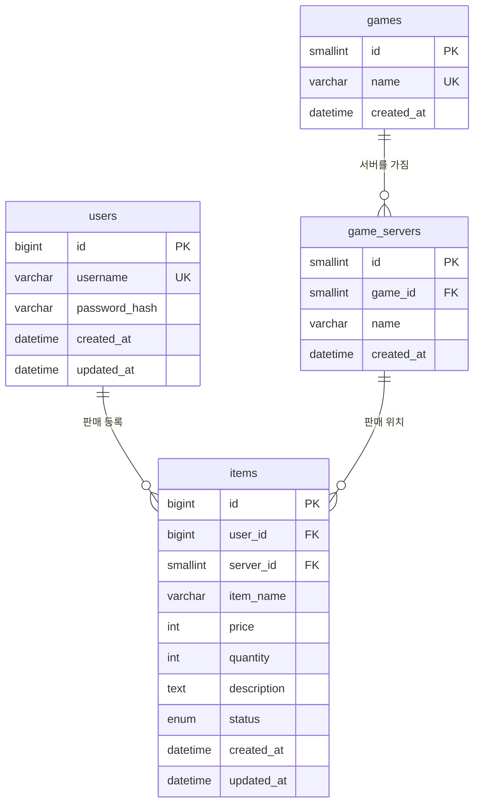
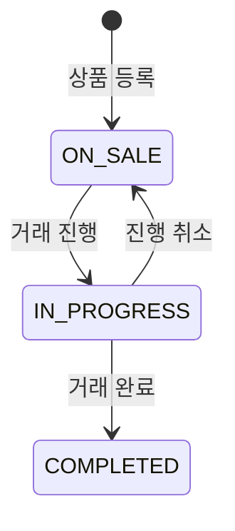

# GameTrade 데이터베이스 설계

상태: 설계안 (구현 전)  
기준일: 2026-10-14  
요구사항: `docs/requirements.md`

구현 단계 전에는 `sql/schema.sql`과 `sql/seed.sql` 파일을 만들지 않는다. 이 문서의 SQL이 그 파일의 원본이다.

기본안은 요구사항 C3의 선택지 A다. `users`, `games`, `game_servers`, `items` 네 테이블이다.

## 1. 설계 기준

- 엔진은 InnoDB, 문자 집합은 `utf8mb4`, 콜레이션은 `utf8mb4_unicode_ci`다.
- 가격은 원 단위 정수다. `INT UNSIGNED`를 사용한다. PDO에서 금액이 문자열이 되는 DECIMAL을 피하고, PHP 초보 단계에서 정수 검증과 맞게 둔다. 상한은 100,000,000원이다. `INT UNSIGNED` 범위 안에 있다.
- 수량은 `INT UNSIGNED`, 1 이상 9,999 이하다.
- 시각은 `DATETIME`이다. `created_at` 기본값은 `CURRENT_TIMESTAMP`, `updated_at`은 갱신 시 `CURRENT_TIMESTAMP`다.
- 비밀번호 컬럼은 `VARCHAR(255)`다. `password_hash(..., PASSWORD_DEFAULT)` 결과를 저장한다. bcrypt는 60자이고, 이후 기본 알고리즘이 바뀌어도 255자 안에 들어가게 둔다. 평문 컬럼은 없다.
- 상태 전환 규칙은 DB 트리거로 만들지 않는다. PHP에서 검사하고, UPDATE의 WHERE에 현재 상태를 넣는다.
- 회원 탈퇴 기능이 없으므로 부모 행 삭제는 애플리케이션 기능이 아니다. 외래 키는 `ON DELETE RESTRICT`로 두어, 실수로 부모를 지울 때 자식이 남지 않게 막는다.
- 상품 삭제는 자식 테이블이 없는 물리 삭제다.

XAMPP의 MariaDB 10.2 이상과 MySQL 8.0.16 이상은 `CHECK`를 강제한다. 구현 1단계에서 `SELECT VERSION();`으로 확인하고, CHECK가 무시되는 구버전이면 애플리케이션 검증만 신뢰한다고 README에 적는다. 스키마의 CHECK는 그대로 둔다.

## 2. 게임과 서버를 나눈 이유

게임 필터가 P0이고 관리자 화면은 없다. 상품마다 게임명 문자열을 넣으면 공백과 표기 차이로 필터가 갈라진다. 시드로 넣는 마스터 테이블이 이 규모에 맞다.

관계:

- 게임 1개는 서버를 여러 개 가진다.
- 서버 1개는 게임 1개에만 속한다.
- 상품은 서버 1개를 참조한다. 게임 id를 상품에 중복 저장하지 않는다. 서버를 알면 게임이 결정되므로, 게임과 서버가 어긋나는 행을 막을 수 있다.

시드에 없는 게임을 사용자가 추가하는 기능은 없다.

선택지 B를 채택하면 이 절의 `games`, `game_servers`와 `items.server_id`를 제거하고, `items`에 `game_name VARCHAR(50) NOT NULL`, `server_name VARCHAR(50) NOT NULL`을 둔다. 아래 CREATE TABLE은 선택지 A다.

## 3. 테이블 명세

### 3.1 `users`

회원을 저장한다. 상품 판매자 외래 키의 부모다.

| 컬럼 | 타입 | NULL | 키 / 제약 | 기본값 | 용도 |
| --- | --- | --- | --- | --- | --- |
| `id` | `BIGINT UNSIGNED` | NO | PK, AUTO_INCREMENT |  | 내부 식별자. 세션에 저장하는 값 |
| `username` | `VARCHAR(20)` | NO | UNIQUE `uk_users_username` |  | 로그인 아이디. 화면에 판매자 이름으로 표시 |
| `password_hash` | `VARCHAR(255)` | NO |  |  | `password_hash()` 결과. 조회 화면에 출력하지 않음 |
| `created_at` | `DATETIME` | NO |  | `CURRENT_TIMESTAMP` | 가입 시각 |
| `updated_at` | `DATETIME` | NO |  | `CURRENT_TIMESTAMP` ON UPDATE | 행 수정 시각. 현재 기능에서는 가입 시와 동일하게 남을 수 있음 |

인덱스는 PK와 `username` UNIQUE뿐이다. 아이디 조회가 로그인 경로다.

### 3.2 `games`

필터와 화면 표시에 쓰는 게임 이름이다.

| 컬럼 | 타입 | NULL | 키 / 제약 | 기본값 | 용도 |
| --- | --- | --- | --- | --- | --- |
| `id` | `SMALLINT UNSIGNED` | NO | PK, AUTO_INCREMENT |  | 목록 필터 `game_id` |
| `name` | `VARCHAR(50)` | NO | UNIQUE `uk_games_name` |  | 화면에 보이는 게임명 |
| `created_at` | `DATETIME` | NO |  | `CURRENT_TIMESTAMP` | 시드 등록 시각 |

게임 수는 적으므로 `SMALLINT`로 충분하다.

### 3.3 `game_servers`

게임에 속한 서버 이름이다.

| 컬럼 | 타입 | NULL | 키 / 제약 | 기본값 | 용도 |
| --- | --- | --- | --- | --- | --- |
| `id` | `SMALLINT UNSIGNED` | NO | PK, AUTO_INCREMENT |  | 상품이 참조하는 서버 |
| `game_id` | `SMALLINT UNSIGNED` | NO | FK → `games.id`, 복합 UNIQUE |  | 이 서버의 게임 |
| `name` | `VARCHAR(50)` | NO | 복합 UNIQUE `uk_game_servers_game_name (game_id, name)` |  | 서버명. 게임 안에서만 유일 |
| `created_at` | `DATETIME` | NO |  | `CURRENT_TIMESTAMP` | 시드 등록 시각 |

같은 서버명이 다른 게임에 있을 수 있다. UNIQUE는 `(game_id, name)`이다. `game_id` 단독 인덱스는 이 UNIQUE의 왼쪽 열로 대체한다.

### 3.4 `items`

판매 상품이다. 회원 1명과 서버 1개를 참조한다.

| 컬럼 | 타입 | NULL | 키 / 제약 | 기본값 | 용도 |
| --- | --- | --- | --- | --- | --- |
| `id` | `BIGINT UNSIGNED` | NO | PK, AUTO_INCREMENT |  | 상품 번호. URL의 `id` |
| `user_id` | `BIGINT UNSIGNED` | NO | FK → `users.id` |  | 판매자 |
| `server_id` | `SMALLINT UNSIGNED` | NO | FK → `game_servers.id` |  | 판매 서버. 게임은 이 값으로 조인 |
| `item_name` | `VARCHAR(100)` | NO |  |  | 아이템명 검색 대상 |
| `price` | `INT UNSIGNED` | NO | CHECK 1 이상 100000000 이하 |  | 판매 가격(원) |
| `quantity` | `INT UNSIGNED` | NO | CHECK 1 이상 9999 이하 |  | 판매 수량. 차감하지 않음 |
| `description` | `TEXT` | YES |  | NULL | 설명. 빈 값이면 NULL |
| `status` | `ENUM('ON_SALE','IN_PROGRESS','COMPLETED')` | NO |  | `ON_SALE` | 거래 상태 코드 |
| `created_at` | `DATETIME` | NO |  | `CURRENT_TIMESTAMP` | 등록 시각. P0 목록 정렬 |
| `updated_at` | `DATETIME` | NO |  | `CURRENT_TIMESTAMP` ON UPDATE | 내용·상태 변경 시각 |

인덱스:

| 이름 | 컬럼 | 용도 |
| --- | --- | --- |
| `idx_items_user_created` | `(user_id, created_at)` | 내 판매 상품. `user_id`만 조건인 조회도 왼쪽 열로 사용 |
| `idx_items_server_id` | `(server_id)` | 서버 조인과 게임 필터의 연결 |
| `idx_items_created_at` | `(created_at)` | 전체 목록 최신순 |
| `idx_items_price` | `(price)` | P1 가격순 |
| `idx_items_status` | `(status)` | 상태 조건 UPDATE. 목록은 상태를 거르지 않아도 비용이 작음 |

`item_name` 인덱스는 두지 않는다. 검색이 `LIKE '%단어%'`라서 일반 B-TREE 인덱스를 타지 않는다. P0 데이터 규모에서는 테이블 스캔으로 충분하다. 전문 검색 인덱스는 추가하지 않는다.

`description`은 선택이며 최대 2,000자는 애플리케이션에서 검사한다. TEXT 자체에는 그 길이를 넣지 않는다.

ENUM을 쓰는 이유: 허용 값이 세 개로 고정되고, 잘못된 문자열 INSERT를 DB가 거절한다. 전환 순서는 ENUM이 보장하지 않으므로 PHP가 보장한다. Q2로 취소 상태를 넣으면 ENUM에 `CANCELLED`를 추가하는 ALTER가 필요하다. 그 결정을 미루기 위해 지금은 세 값만 둔다.

## 4. CREATE TABLE

데이터베이스 이름: `gametrade`.

애플리케이션 계정은 `gametrade` 스키마에 대해 `SELECT`, `INSERT`, `UPDATE`, `DELETE`만 가진다. `DROP`, `ALTER`, `CREATE`는 로컬 관리 계정으로 스키마를 적용할 때만 사용한다.

```sql
CREATE DATABASE IF NOT EXISTS gametrade
  CHARACTER SET utf8mb4
  COLLATE utf8mb4_unicode_ci;

USE gametrade;

CREATE TABLE users (
  id BIGINT UNSIGNED NOT NULL AUTO_INCREMENT COMMENT '내부 식별자',
  username VARCHAR(20) NOT NULL COMMENT '로그인 아이디',
  password_hash VARCHAR(255) NOT NULL COMMENT 'password_hash() 결과',
  created_at DATETIME NOT NULL DEFAULT CURRENT_TIMESTAMP COMMENT '가입 시각',
  updated_at DATETIME NOT NULL DEFAULT CURRENT_TIMESTAMP ON UPDATE CURRENT_TIMESTAMP COMMENT '수정 시각',
  PRIMARY KEY (id),
  UNIQUE KEY uk_users_username (username)
) ENGINE=InnoDB DEFAULT CHARSET=utf8mb4 COLLATE=utf8mb4_unicode_ci COMMENT='회원';

CREATE TABLE games (
  id SMALLINT UNSIGNED NOT NULL AUTO_INCREMENT COMMENT '게임 식별자',
  name VARCHAR(50) NOT NULL COMMENT '게임명',
  created_at DATETIME NOT NULL DEFAULT CURRENT_TIMESTAMP COMMENT '등록 시각',
  PRIMARY KEY (id),
  UNIQUE KEY uk_games_name (name)
) ENGINE=InnoDB DEFAULT CHARSET=utf8mb4 COLLATE=utf8mb4_unicode_ci COMMENT='게임';

CREATE TABLE game_servers (
  id SMALLINT UNSIGNED NOT NULL AUTO_INCREMENT COMMENT '서버 식별자',
  game_id SMALLINT UNSIGNED NOT NULL COMMENT '소속 게임',
  name VARCHAR(50) NOT NULL COMMENT '서버명',
  created_at DATETIME NOT NULL DEFAULT CURRENT_TIMESTAMP COMMENT '등록 시각',
  PRIMARY KEY (id),
  UNIQUE KEY uk_game_servers_game_name (game_id, name),
  CONSTRAINT fk_game_servers_game
    FOREIGN KEY (game_id) REFERENCES games (id)
    ON DELETE RESTRICT
    ON UPDATE CASCADE
) ENGINE=InnoDB DEFAULT CHARSET=utf8mb4 COLLATE=utf8mb4_unicode_ci COMMENT='게임 서버';

CREATE TABLE items (
  id BIGINT UNSIGNED NOT NULL AUTO_INCREMENT COMMENT '상품 식별자',
  user_id BIGINT UNSIGNED NOT NULL COMMENT '판매자',
  server_id SMALLINT UNSIGNED NOT NULL COMMENT '판매 서버',
  item_name VARCHAR(100) NOT NULL COMMENT '아이템명',
  price INT UNSIGNED NOT NULL COMMENT '판매 가격(원)',
  quantity INT UNSIGNED NOT NULL COMMENT '판매 수량',
  description TEXT NULL COMMENT '아이템 설명',
  status ENUM('ON_SALE', 'IN_PROGRESS', 'COMPLETED') NOT NULL DEFAULT 'ON_SALE' COMMENT '거래 상태',
  created_at DATETIME NOT NULL DEFAULT CURRENT_TIMESTAMP COMMENT '등록 시각',
  updated_at DATETIME NOT NULL DEFAULT CURRENT_TIMESTAMP ON UPDATE CURRENT_TIMESTAMP COMMENT '수정 시각',
  PRIMARY KEY (id),
  KEY idx_items_user_created (user_id, created_at),
  KEY idx_items_server_id (server_id),
  KEY idx_items_created_at (created_at),
  KEY idx_items_price (price),
  KEY idx_items_status (status),
  CONSTRAINT fk_items_user
    FOREIGN KEY (user_id) REFERENCES users (id)
    ON DELETE RESTRICT
    ON UPDATE CASCADE,
  CONSTRAINT fk_items_server
    FOREIGN KEY (server_id) REFERENCES game_servers (id)
    ON DELETE RESTRICT
    ON UPDATE CASCADE,
  CONSTRAINT chk_items_price CHECK (price >= 1 AND price <= 100000000),
  CONSTRAINT chk_items_quantity CHECK (quantity >= 1 AND quantity <= 9999)
) ENGINE=InnoDB DEFAULT CHARSET=utf8mb4 COLLATE=utf8mb4_unicode_ci COMMENT='판매 상품';
```

`ON UPDATE CASCADE`는 부모 PK가 바뀔 때의 규칙이다. 애플리케이션은 PK를 수정하지 않는다. 삭제는 `RESTRICT`다.

## 5. 시드 데이터

샘플은 가상 게임이다. 상용 게임 이름과 서버 구성을 가져오지 않는다.

| 게임 | 서버 |
| --- | --- |
| 루멘판타지 | 루멘, 녹스 |
| 철기전기 | 1서버, 2서버 |
| 아스트라온라인 | 오리온, 시리우스 |

상품 시드가 필요하면 회원 1명을 먼저 넣는다. 비밀번호 해시는 SQL에 추측 가능한 평문을 적지 않고, 구현 때 로컬에서 한 번 생성한다.

```bash
php -r "echo password_hash('change-me', PASSWORD_DEFAULT), PHP_EOL;"
```

`change-me`는 자리 표시자다. 실제 시드 비밀번호는 로컬에서만 정하고, README에는 "샘플 계정이며 운영 비밀번호가 아니다"라고 적는다. 해시 문자열을 설계 문서에 고정하지 않는다. `PASSWORD_DEFAULT` 결과가 환경마다 달라질 수 있기 때문이다.

시드 상품은 각 상태(`ON_SALE`, `IN_PROGRESS`, `COMPLETED`)가 목록에 최소 1건씩 보이게 3건 이상 넣는다. 판매자 표시와 권한 테스트를 위해 회원은 2명 이상 둔다.

삽입 순서는 `users` → `games` → `game_servers` → `items`다.

## 6. 관계와 참조 무결성

### 6.1 각 테이블의 역할

| 테이블 | 역할 |
| --- | --- |
| `users` | 로그인 주체이자 판매자 |
| `games` | 게임 필터의 기준 데이터 |
| `game_servers` | 게임 안의 서버. 상품이 직접 연결되는 판매 위치 |
| `items` | 판매 정보와 거래 상태 |

### 6.2 일대다

- 회원 1명 : 상품 N개. 상품은 회원 1명을 `user_id`로 가리킨다. 상품 없는 회원은 있을 수 있다. 회원 없는 상품은 `user_id NOT NULL`과 FK 때문에 있을 수 없다.
- 게임 1개 : 서버 N개. 서버는 게임 1개를 `game_id`로 가리킨다.
- 서버 1개 : 상품 N개. 상품은 서버 1개를 `server_id`로 가리킨다.
- 게임과 상품 사이에는 직접 외래 키가 없다. 목록에서 게임명이 필요하면 `items` → `game_servers` → `games`로 조인한다.

### 6.3 삭제 정책

| 상황 | 처리 |
| --- | --- |
| 애플리케이션에서 상품 삭제 | 작성자이고 상태가 `ON_SALE`일 때만 `DELETE FROM items` |
| `users` 행 삭제 | 기능 없음. 상품이 있으면 FK가 거절. 상품이 없어도 탈퇴 기능을 만들지 않음 |
| `games` 또는 `game_servers` 삭제 | 기능 없음. 서버나 상품이 참조하면 FK가 거절 |
| `COMPLETED` 상품 | 기본안은 삭제 버튼을 제공하지 않음. 이력 보존용 별도 테이블은 없음 |
| 부모 PK 변경 | 기능 없음. FK는 `ON UPDATE CASCADE` |

연쇄 삭제(`ON DELETE CASCADE`)는 사용하지 않는다. 회원 한 명을 지울 때 판매 글이 함께 사라지는 동작을 기본값으로 두지 않기 위해서다.

### 6.4 ERD



읽는 방법:

- `||`는 반드시 1건, `o{`는 0건 이상이다.
- 상품 쪽의 `user_id`는 `users.id`를 가리키는 외래 키다.
- 상품 쪽의 `server_id`는 `game_servers.id`를 가리키는 외래 키다.
- 서버 쪽의 `game_id`는 `games.id`를 가리키는 외래 키다.
- `password_hash`는 관계에 쓰이지 않는다. 인증 입력과 `password_verify()`로만 비교한다.

## 7. 상태 값

화면 라벨은 DB에 저장하지 않는다. PHP 배열로만 매핑한다.



`COMPLETED`에서는 나가는 전이가 없다.

Q2를 채택해 취소 상태를 넣는 경우에만 아래를 추가한다. 기본 스키마에는 포함하지 않는다.

- ENUM에 `CANCELLED`
- `ON_SALE` → `CANCELLED`
- `IN_PROGRESS` → `CANCELLED`
- `CANCELLED` → `ON_SALE`
- `CANCELLED`에서는 내용 수정과 삭제를 `ON_SALE`과 같이 허용할지를 Q3과 함께 다시 정한다

## 8. 조회와 변경 쿼리

SQL 조각은 코드에 적힌 고정 문자열만 이어 붙인다. 요청 값으로 컬럼명이나 ORDER BY 절을 만들지 않는다. 값은 모두 바인딩한다.

### 8.1 목록

게임 필터와 검색어가 있을 때만 해당 줄을 붙인다.

```sql
SELECT
  i.id,
  i.item_name,
  i.price,
  i.quantity,
  i.status,
  i.created_at,
  g.id AS game_id,
  g.name AS game_name,
  s.name AS server_name
FROM items AS i
INNER JOIN game_servers AS s ON s.id = i.server_id
INNER JOIN games AS g ON g.id = s.game_id
WHERE 1 = 1
  /* 선택: AND g.id = :game_id */
  /* 선택: AND i.item_name LIKE :item_name */
ORDER BY i.created_at DESC, i.id DESC;
```

P1 페이지네이션은 목록 쿼리 끝에 `LIMIT :limit OFFSET :offset`을 붙인다. `:limit`은 10으로 고정하고, `:offset`은 `(page - 1) * 10`이다. 둘 다 정수로 바인딩한다. 개수 표시가 필요하면 같은 WHERE로 `COUNT(*)`를 따로 실행한다.

P1 정렬은 ORDER BY만 바꾼다.

```sql
-- latest
ORDER BY i.created_at DESC, i.id DESC
-- price_asc
ORDER BY i.price ASC, i.id DESC
-- price_desc
ORDER BY i.price DESC, i.id DESC
```

검색 바인딩 값은 애플리케이션이 `%`와 `_`를 제거한 뒤 양쪽에 `%`를 붙인 문자열이다. 사용자가 보낸 `%`를 패턴으로 해석하지 않는다.

### 8.2 상세

```sql
SELECT
  i.id,
  i.user_id,
  i.item_name,
  i.price,
  i.quantity,
  i.description,
  i.status,
  i.created_at,
  i.updated_at,
  u.username,
  g.id AS game_id,
  g.name AS game_name,
  s.id AS server_id,
  s.name AS server_name
FROM items AS i
INNER JOIN users AS u ON u.id = i.user_id
INNER JOIN game_servers AS s ON s.id = i.server_id
INNER JOIN games AS g ON g.id = s.game_id
WHERE i.id = :id;
```

결과가 0건이면 404다.

### 8.3 내 판매 상품

```sql
SELECT
  i.id,
  i.item_name,
  i.price,
  i.quantity,
  i.status,
  i.created_at,
  g.name AS game_name,
  s.name AS server_name
FROM items AS i
INNER JOIN game_servers AS s ON s.id = i.server_id
INNER JOIN games AS g ON g.id = s.game_id
WHERE i.user_id = :user_id
ORDER BY i.created_at DESC, i.id DESC;
```

### 8.4 등록

```sql
INSERT INTO items (
  user_id, server_id, item_name, price, quantity, description, status
) VALUES (
  :user_id, :server_id, :item_name, :price, :quantity, :description, 'ON_SALE'
);
```

`user_id`는 세션 값이다. 폼에서 받지 않는다.

서버 존재 확인:

```sql
SELECT s.id, s.game_id, s.name, g.name AS game_name
FROM game_servers AS s
INNER JOIN games AS g ON g.id = s.game_id
WHERE s.id = :server_id;
```

0건이면 "서버를 선택하세요."와 같은 검증 오류로 저장하지 않는다.

### 8.5 수정

```sql
UPDATE items
SET
  server_id = :server_id,
  item_name = :item_name,
  price = :price,
  quantity = :quantity,
  description = :description
WHERE id = :id
  AND user_id = :user_id
  AND status = 'ON_SALE';
```

실행 전에 상세 조회로 존재와 작성자를 확인해 404와 403을 나눈다. UPDATE의 `user_id`, `status` 조건은 그 사이 요청을 한 번 더 막는다. `rowCount`가 0이면 "현재 상태에서는 수정할 수 없습니다."를 보여 준다.

### 8.6 삭제

```sql
DELETE FROM items
WHERE id = :id
  AND user_id = :user_id
  AND status = 'ON_SALE';
```

존재와 작성자 구분은 수정과 같이 SELECT를 먼저 한다.

### 8.7 상태 변경

```sql
UPDATE items
SET status = :next_status
WHERE id = :id
  AND user_id = :user_id
  AND status = :current_status;
```

`:next_status`는 PHP 허용 표에 있는 값만 바인딩한다. `rowCount`가 0이면 갱신하지 않은 것으로 보고 상세 화면에서 다시 조회한 뒤 메시지를 보여 준다.

### 8.8 회원

```sql
SELECT id, username, password_hash
FROM users
WHERE username = :username;
```

```sql
INSERT INTO users (username, password_hash)
VALUES (:username, :password_hash);
```

중복 아이디는 UNIQUE가 거절한다. 애플리케이션은 SQLSTATE `23000`의 중복 키를 사용자 메시지로 바꾼다. 다른 SQLSTATE는 로그에만 남기고 일반 오류 메시지를 보여 준다.

## 9. 샘플 규모와 인덱스

로컬 시드는 수십 건을 넘기지 않는다. 이 규모에서 `LIKE '%단어%'`와 페이지 없는 목록은 허용한다. 인덱스를 더 복잡하게 만들거나 FULLTEXT를 넣지 않는다.
